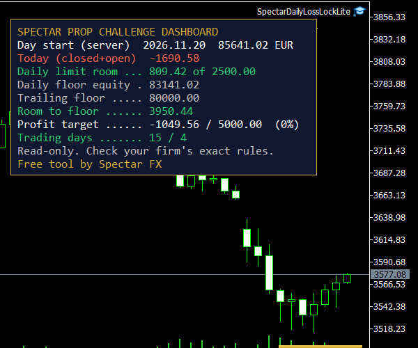
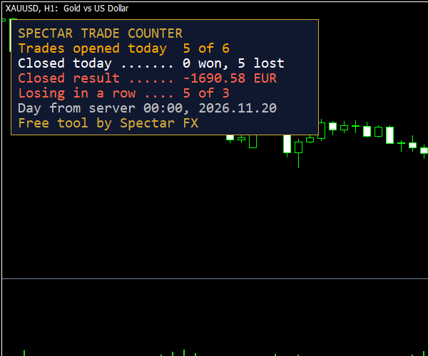
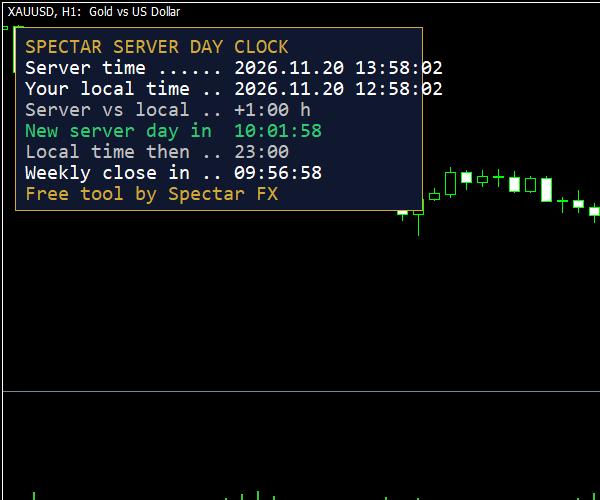

# More free MT5 tools

Three small read-only indicators for MetaTrader 5. None of them opens, modifies or closes a trade. No DLLs, no web requests. You type every number yourself; nothing is preset.

Copy the `.mq5` file to `MQL5/Indicators`, compile it in MetaEditor and drag it onto a chart.

## Spectar Prop Challenge Dashboard
One panel with the numbers a prop-style challenge is judged on: today's result from broker server midnight (closed plus floating), room left to your own daily loss limit, a static or trailing overall floor, profit target progress and trading days.

## Spectar Trade Counter
Trades opened today from broker server midnight next to your own maximum, losing trades in a row next to your own maximum, and today's closed result. Optional alert.

## Spectar Server Day Clock
Broker server time, your local time, the offset between them, and countdowns to the next server day (when daily loss limits usually reset) and to the weekly close.

Rule sets differ between firms and change over time. Check the exact wording of your own firm's rules.
Trading involves a high risk of loss. These are tools, not advice.
